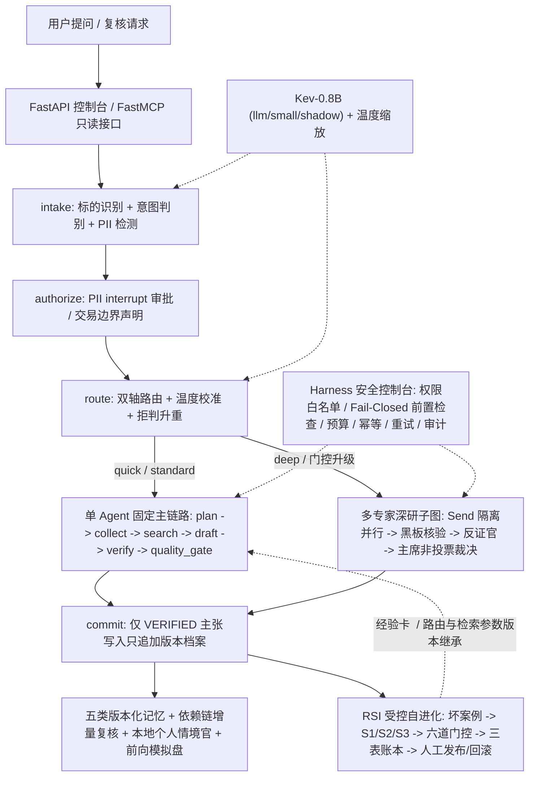

# VeriFolio（溯研）

**基于 Harness Engineering 的可信投研多 Agent 系统**

> 不预测涨跌、不提供买卖指令——让每一次投研产出的结论都**查得到出处、对得上口径、留得住分歧、随新信息增量更新**。

---

## 系统定位与设计原则

针对通用“ReAct + 多 Agent 助手”在金融投研中的幻觉编数、转载刷票、前视偏差、成本不可控与错误反复重演等痛点，VeriFolio 通过 **Harness Engineering** 将“做什么”交给模型、将“能做什么、花多少、何时停下、能否入结论”收归确定性代码：

- **可信证据与纯规则核验**：结构化财报、行情、巨潮公告与 `Decimal` 派生计算为 **A 级事实**，网页按权威度与全文快照分为 **B / C 级线索**；严格按披露日（`disclosed_at <= as_of`）防前视偏差，通过 64-bit SimHash 合并转载同源；8 步纯规则核验器保证结论数字必须在 A 级证据中按书写精度半单位复算，**C 级线索进入结论 0 次**。
- **Harness 安全控制台与 LangGraph 状态图**：固定 `intake → authorize → route → plan → collect → search → draft → verify → quality_gate → commit` 编排链路；统一执行 Skill 白名单、`action.*` 交易禁令、Fail-Closed 前置校验与隐私外发拦截、600 秒参数哈希审批票据、同任务幂等、指数退避重试、四维预算上限、OpenTelemetry 风格全链路审计，以及基于 Checkpointer 的原生 `interrupt()` / `Command(resume=...)` 人在环续跑。
- **双轴路由与概率校准**：任务轴（`quick / standard / deep`）与模型轴（[config/models.yaml](./config/models.yaml)）彻底解耦；判别概率经温度缩放校准（Temperature Scaling / ECE / NLL），置信度低于 `0.55` 时拒判并向更重档位升级，确保高风险深研 **100% 召回** 与交易意图 **20/20 零误报**。
- **多专家争议深研子图**：主席按证据缺口召集最多 5 位专家与 1 位反证官，基于 LangGraph `Send` 并行下发并强制**首轮物理隔离**（越权引用直接驳回）；反证官质询因果漏洞后由主席按去重独立来源**非投票裁决**，保留多空分歧，高危未决争议提交前 `interrupt` 人工复核。
- **五类版本化记忆与前向模拟盘**：强写入权限隔离 + 只追加决策档案版本链（`Claim → Evidence → ReportPeriod` 依赖图）；四类变更订阅扫描驱动增量复核（保留 / 削弱 / 失效）；纯本地规则个人情境官（隐私不出本机）；以及禁止历史回填的等权整手前向模拟盘与 5 条纯代码晋级门控。
- **RSI 受控自进化闭环**：不训练模型权重，仅针对外围资产（S1 经验卡 / S2 路由参数 / S3 检索模板）做单点迭代；通过三权分立、六道纯代码门控（协议一致、防泄漏、防过拟合 + 行业词表、噪声门控、成本门控、回归门控）、只追加三表事件溯源账本与人工批准/一键回滚实现可验证的递归继承。
- **System 1 混合判别、FastMCP 与控制台**：意图与路由判别节点支持 `llm / small / shadow` 三态切换，接入本地零训练概率决策模型 **Kev-0.8B**（Apple Silicon MLX，不可用时自动回退大模型），路由中位耗时由 `2222 ms` 降至 `69 ms` 且多次运行完全一致；提供只读 FastMCP 工具接口、FastAPI 后端与 5-Tab 控制台。

---

## 总体架构



---

## 核心基准与验证结果

| 维度 | 指标 |
| :--- | :--- |
| 计算与可信度 | 计算类金标 **14/14（100%）** 通过；纯规则核验下 **C 级线索进入结论 0 次** |
| 路由与混合判别（24 题金标） | Kev-0.8B 准确率 **95.8%**、深研召回 **100%**、中位耗时 **2222 ms → 69 ms**、3 次重复 **100% 一致** |
| 意图识别（38 原集 + 26 留出集） | 原集 **97.4%** / 留出集 **100%**；下单意图 **20/20 召回、0 误报**；中位耗时 **43 ms** |
| 真实提问回放（22 条） | Kev-0.8B 与大模型路由结果 **22/22（100%）一致** |
| 自动化测试 | **93 项** 离线确定性单元与集成测试（覆盖证据核验、Harness、LangGraph、深研、记忆、RSI、Kev、MCP 与 API） |

---

## 快速开始

支持纯 CPU 离线确定性运行（无需独立显卡与外部 API Key），同时在适配器层预留了 DeepSeek / AKShare / MongoDB / MLX 接入协议。

```bash
# 1. 安装依赖（Python >= 3.11，推荐使用 uv）
uv sync --extra dev

# 2. 运行全量测试套件（93 项）
uv run pytest -v

# 3. 运行端到端流程示例
uv run python examples/stage1_demo.py   # A/B/C 证据分级、SimHash 去重与规则核验
uv run python examples/stage2_demo.py   # Harness 控制台、PII interrupt/resume 与补证
uv run python examples/stage3_demo.py   # 双轴路由、温度缩放校准与基准评测
uv run python examples/stage4_demo.py   # 多专家争议深研与单 Agent 对照评测
uv run python examples/stage5_demo.py   # 版本化记忆、增量复核与前向模拟盘
uv run python examples/stage6_demo.py   # RSI 六道门控、账本发布与递归继承
uv run python examples/stage7_demo.py   # Kev-0.8B 混合判别、FastMCP 与 API 冒烟

# 4. 启动本地 FastAPI 服务与 5-Tab 控制台（http://127.0.0.1:8000）
uv sync --extra server
uv run uvicorn zhengyan.api.app:app --reload
```

---

## 目录结构

```text
├── config/                 # 策略配置：policies / models / search_sources / industry_terms
├── evals/golden/           # 基准评测集：计算金标、路由24题、意图38+26题、A/B对照、真实回放22题
├── src/zhengyan/
│   ├── core/               # Pydantic v2 核心数据契约与枚举
│   ├── data/               # Point-in-Time 数据适配器与 Decimal 计算 Skill
│   ├── search/             # 白名单过滤、SimHash 转载去重、提示注入清洗与 B/C 分级
│   ├── verify/             # 8 步纯规则核验器与中文金融数字解析
│   ├── harness/            # 安全控制台（权限、隐私、审批票据、预算、幂等、重试、审计）
│   ├── graph/              # LangGraph 10 节点固定主图与检查点续跑
│   ├── routing/            # 双轴路由、温度校准（ECE/NLL）、Kev-0.8B 混合与影子模式
│   ├── deep/               # LangGraph Send 并行多专家深研子图与对照评测
│   ├── memory/             # 五类版本化记忆、增量复核、个人情境官与前向模拟盘
│   ├── rsi/                # RSI 只追加三表账本、六道硬门控与 S1/S2/S3 进化通道
│   ├── api/                # FastAPI 后端接口
│   └── mcp_server.py       # FastMCP 只读 Skill 服务层
├── web/                    # 轻量 5-Tab 控制台前端
├── tests/                  # 全链路 93 项测试套件
├── examples/               # 端到端可执行示例脚本
└── docs/                   # 架构设计与模块说明文档
```

---

## 架构文档

各模块详细设计说明与架构流程图见 [docs/README.md](./docs/README.md)：

- [证据分级、时点纪律与规则核验](./docs/stage1_evidence_and_verifier.md)
- [Harness 安全控制台与 LangGraph 主图](./docs/stage2_harness_and_langgraph.md)
- [双轴路由、概率校准与评测体系](./docs/stage3_dual_axis_routing_and_calibration.md)
- [多专家争议深研子图与对照评测](./docs/stage4_multi_expert_deep_research.md)
- [版本化记忆、增量复核与前向模拟盘](./docs/stage5_versioned_memory_and_paper_trading.md)
- [RSI 受控自进化闭环与六道门控](./docs/stage6_rsi_self_improvement.md)
- [Kev-0.8B 混合判别、FastMCP 与控制台](./docs/stage7_kev_hybrid_mcp_and_api.md)
