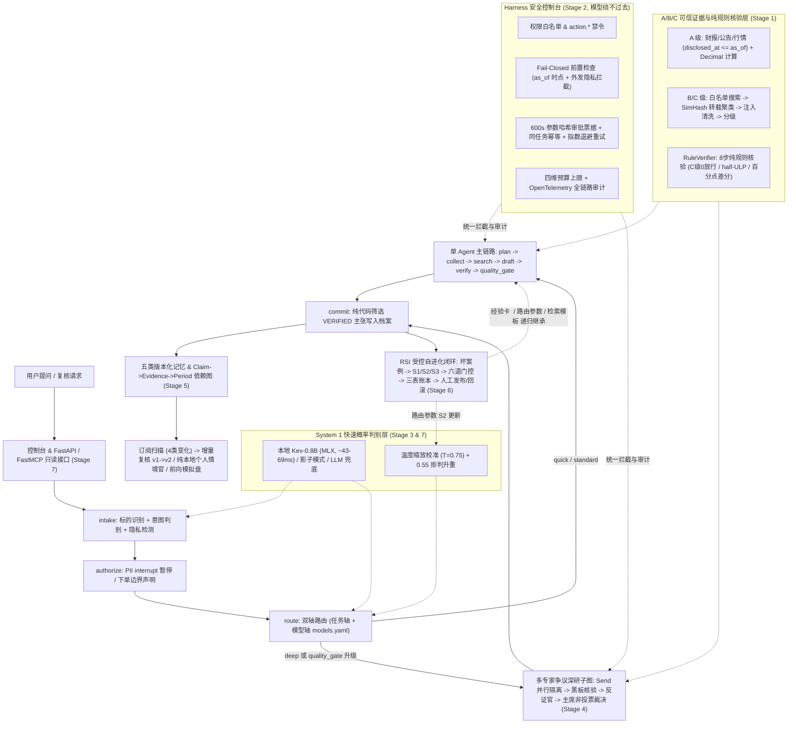

# 证研（ZhengYan）分阶段学习与面试复盘文档总索引

本目录将项目原始需求与设计文档中的背景、迭代路线、核心架构问题，与本仓库亲手还原的 **7 个可运行代码阶段（93 项单测）** 逐一绑定，并补全了 **10 张核心 Mermaid 架构与流程图**。

> **适合人群与阅读方式**：面向 **AI 应用 / Agent 算法岗（兼顾开发岗）**。建议按 Stage 1 → Stage 7 顺序阅读，每看完一章立刻跑一遍对应的 `examples/stageX_demo.py` 和 `tests/stageX/`，并顺着章末的“面试高频追问”口述演练一遍。

---

## 一、总体架构图（还原原文档图 1）



---

## 二、7 个阶段专题文档地图

| 阶段文档 | 核心主题 | 对应原文档面试题与八股 | 演示与单测入口 |
| :--- | :--- | :--- | :--- |
| [Stage 1 文档](./stage1_evidence_and_verifier.md) | 数据契约、A/B/C 证据分级、时点纪律、SimHash 与纯规则核验器 | 项目题 1、6、7、8、9、10、30；八股：RAG、SimHash、提示注入、前视偏差、Decimal | `examples/stage1_demo.py`<br>`tests/stage1/`（29 项） |
| [Stage 2 文档](./stage2_harness_and_langgraph.md) | Harness 安全控制台 + LangGraph 10 节点固定状态图与 `interrupt` 续跑 | 项目题 2、3、11、12、16、28、29、30；八股：Agent 基础、ReAct vs 状态机、LangGraph、Harness、幂等、重试、OTel | `examples/stage2_demo.py`<br>`tests/stage2/`（18 项） |
| [Stage 3 文档](./stage3_dual_axis_routing_and_calibration.md) | 双轴路由、温度缩放校准（ECE / NLL）、拒判升重与 24+64 题评测 | 项目题 1、4、5、27；八股：模型校准、ECE、温度缩放、随机波动检验 | `examples/stage3_demo.py`<br>`tests/stage3/`（14 项） |
| [Stage 4 文档](./stage4_multi_expert_deep_research.md) | 多专家争议深研子图（`Send` 并行、首轮隔离、非投票裁决）与对照评测 | 项目题 1、13、14、15、16、27、28；八股：多 Agent 框架对比、LangGraph `Send` | `examples/stage4_demo.py`<br>`tests/stage4/`（7 项） |
| [Stage 5 文档](./stage5_versioned_memory_and_paper_trading.md) | 五类版本化记忆、依赖链增量复核、纯本地个人情境官与前向模拟盘 | 项目题 12、17、18、31、32；八股：前视偏差、幸存者偏差 | `examples/stage5_demo.py`<br>`tests/stage5/`（7 项） |
| [Stage 6 文档](./stage6_rsi_self_improvement.md) | RSI 受控自进化闭环、三权分立、只追加三表账本与六道硬门控 | 项目题 1、19–25、27、33；八股：平衡准确率、Goodhart 定律、RSI vs Reflexion | `examples/stage6_demo.py`<br>`tests/stage6/`（12 项） |
| [Stage 7 文档](./stage7_kev_hybrid_mcp_and_api.md) | 本地小模型 Kev-0.8B 混合判别、影子模式、FastMCP 与 FastAPI 控制台 | 项目题 1、26、30、34、35；八股：System 1/2、Skills vs MCP | `examples/stage7_demo.py`<br>`tests/stage7/`（6 项） |

---

## 三、算法岗面试 3 分钟主线串讲脚本（把 7 个阶段连成一个迭代故事）

面试官问“介绍一下你这个投研 Agent 项目”时，切忌平铺直叙报技术栈，一定要按 **“痛点 → 迭代 → 量化证据 → 已知短板”** 的因果链推进：

1. **地基（Stage 1 + 2）**：最早用 ReAct 多 Agent 时模型跳过取数编数字、转载刷票、成本失控。我先用 **LangGraph 固定状态图 + Harness 控制台**把“能做什么”收归代码，并落地 **A/B/C 证据分级 + SimHash 去重 + 纯规则核验器**——计算金标 14/14（100%）通过，C 级线索进结论 0 次。
2. **路由与校准（Stage 3）**：全走重流程太慢，于是做**任务轴 × 模型轴双轴路由**，对判别概率做**温度缩放（T=0.75）**并在 `<0.55` 时**向重档位拒判升级**，保证深研召回 100%。中途踩过“改温度重跑 24 题从 92% 掉到 83%”的坑，用原始概率回放定位出是 LLM 随机波动，后来沉淀为噪声门控。
3. **多专家对抗（Stage 4）**：针对高分歧决策，用 LangGraph `Send` 并行召集 ≤5 专家**首轮隔离取证**防从众，再由反证官挑因果漏洞（如茅台合同负债 -42% 被渠道打款节奏反证推翻）、主席按**去重独立来源**非投票裁决。用纯代码综合质量分做单 Agent 对照，质量提升且成本在 3–4x 准入上限内，默认仍走单 Agent。
4. **长期记忆与防过拟合（Stage 5）**：不用向量库而用**只追加版本链 + `主张 → 证据 → 报告期` 依赖图**，实现宁德时代“新财报/异动提醒 → 增量重研 → v2”；用**前向模拟盘（禁回填）**替代易过拟合的历史回测。
5. **受控自进化 RSI（Stage 6）**：不训权重，只改经验卡 / 路由参数 / 检索模板三类外围资产。核心是**三权分立 + 六道代码门控（协议一致、防泄漏、防过拟合、噪声、成本、回归）+ 只追加三表账本**，把贵的多专家教训（如 L-007）沉淀给便宜的单 Agent 继承，在 1:2 样本上平衡准确率显著提升、OOT 不退化。
6. **System 1 混合判别（Stage 7）**：判别节点从 DeepSeek 切到本地零训练 **Kev-0.8B（MLX, ~3GB）**，支持 `llm / small / shadow` 三态灰度与自动回退：路由准确率 95.8%、深研召回 100%、中位耗时从 2222ms 降到 69ms 且 3 次零波动；同时坦诚暴露 **20.8% 拒判率偏高** 的短板，并指出须走 S2 RSI 门控重新校准温度而非手动硬改。

---

## 四、一键验证全项目

```bash
# 全量 93 项离线确定性回归测试（约 1 秒）
uv run pytest -v

# 按阶段依次运行 7 个端到端演示脚本
for i in 1 2 3 4 5 6 7; do uv run python examples/stage${i}_demo.py; done
```
