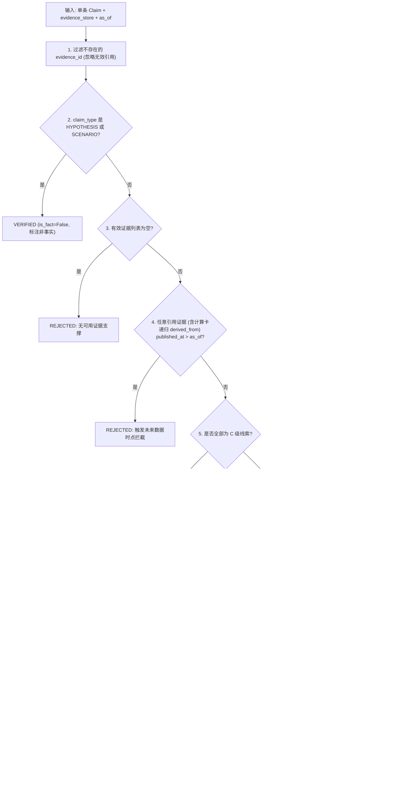

# Stage 1：数据契约、A/B/C 证据链路与纯规则核验器

> **对应原文档章节**：项目题第 1、6、7、8、9、10、30 题；八股：RAG 与结构化取数、SimHash、提示注入、前视偏差、Decimal。

---

## 一、本阶段要解决的痛点

初版“ReAct + 多 Agent”在投研场景暴露出三个致命底线问题：
1. **模型编数字**：财报里没有“毛利率同比提升 3 个百分点”，模型也能写得有模有样；
2. **转载刷票与网页污染**：同一篇新闻被 10 家网站转载就被当成 10 条独立证据；网页里还可能暗藏恶意提示注入；
3. **前视偏差（Look-ahead Bias）**：拿报告期截止日（如 `2024-12-31`）而非实际披露日（`2025-04-03`）取数，导致在历史时点偷看到了未来财报。

**Stage 1 的核心思想**：不靠 Prompt 反复叮嘱“请不要编造数字”，而是从数据结构、取数边界、网页流水线到纯规则核验器，**用确定性代码把底线彻底封死**。

---

## 二、纯规则核验器 8 步流程（还原原文档第 7 题配图）



---

## 三、本阶段代码地图与设计导读

| 模块文件 | 核心类 / 函数 | 设计意图与必看细节 |
| :--- | :--- | :--- |
| [enums.py](../src/zhengyan/core/enums.py) | `EvidenceGrade`, `AccountingBasis`, `MetricUnit`, `ClaimType`, `VerificationStatus` | 强类型枚举，明确区分 `CUMULATIVE` / `SINGLE_QUARTER` / `NON_GAAP` 口径，防止跨口径硬算 |
| [models.py](../src/zhengyan/core/models.py) | `FinancialStatementRecord`, `EvidenceCard`, `Claim`, `VerificationResult` | 全链路使用 `Decimal`；`FinancialStatementRecord` 严格区分 `period_end` 与 `disclosed_at`；`EvidenceCard.derived_from` 记录计算血缘 |
| [mock_provider.py](../src/zhengyan/data/mock_provider.py) | `MockMarketDataProvider` | 实现 `MarketDataProvider` 协议，严格按 `disclosed_at <= as_of` 过滤，内置茅台 `600519`（含合同负债 `-42%`）与宁德时代 `300750` 多期数据 |
| [compute_skills.py](../src/zhengyan/data/compute_skills.py) | `compute_yoy_growth`, `compute_single_quarter`, `compute_ratio`, `compute_pe_ttm_pit`, `half_ulp_tolerance` | 全 `Decimal` 精确计算；`compute_pe_ttm_pit` 严格用 `prev_fy + latest_cum - prior_same_cum` 按披露日对齐，缺期直接报错不瞎猜 |
| [simhash.py](../src/zhengyan/search/simhash.py) | `normalize_title`, `compute_simhash64`, `hamming_distance`, `extract_original_source` | 字符 bigram + `blake2b` 确定性 64-bit 哈希按位加权投票，汉明距离 `<= 10` 归并同簇 |
| [sanitizer.py](../src/zhengyan/search/sanitizer.py) | `sanitize_html`, `format_as_untrusted_data_block` | 剥离 HTML/script/style/img，逐行删除疑似注入句式并打标 `suspected_injection`，输出 `<untrusted_web_evidence>` 隔离块 |
| [pipeline.py](../src/zhengyan/search/pipeline.py) | `SourcePolicy`, `WebSearchPipeline` | 自动拼 `-site:` 黑名单与 120 天窗口；先按站点权威度降序再聚类，保证簇代表最权威；严格判定 B/C 级 |
| [number_parser.py](../src/zhengyan/verify/number_parser.py) | `extract_financial_numbers`, `to_base_cny` | 只抽带金融单位数字（自动忽略股票代码/年份）；结合前置词识别正负方向（防把“下降 42%”写成“增长 42%”）；支持 亿元↔万元↔元 精确换算 |
| [verifier.py](../src/zhengyan/verify/verifier.py) | `RuleVerifier` | 零模型调用、100% 确定性 8 步核验；支持计算卡 `derived_from` 递归展开与 `个百分点` 跨期差分匹配 |
| [compute_cases.json](../evals/golden/compute_cases.json) | 14 例计算金标 | 覆盖同口径同比、单季推算、比率、披露日对齐 PE(TTM) 与 `NON_GAAP` 跨口径拒绝负例 |

---

## 四、算法与工程深度精讲

### 1. A / B / C 三级证据铁律
| 等级 | 来源与准入条件 | 允许用途 |
| :--- | :--- | :--- |
| **A 级** | 结构化财报、行情、巨潮公告、系统 Decimal 计算卡 | 支撑数值结论与计算输入 |
| **B 级** | 网页，且**同时满足**：站点权威度 `>= 3`、已抓全文快照、发布日期可知且 `<= as_of`（窗口内） | 只能说明“发生了什么”，须标来源，**数字不能进结论** |
| **C 级** | 缺日期 / 无快照 / 权威度不足等其他网页 | 仅触发“去查证”，**进入结论 0 次** |

### 2. half-ULP（书写精度半单位）容差与百分点差分
- 模型把 `9.10%` 简写成 `9.1%` 属于合理四舍五入，不能误杀；但写成 `9.2%` 就是错误。
- `half_ulp_tolerance("9.1")` 算出小数位 `d=1`，允许误差 $\pm 0.5 \times 10^{-1} = \pm 0.05$，区间 $[9.05, 9.15]$ 命中 `9.10%`，拦截 `9.2%`。
- 对于 `个百分点`（如“毛利率同比下降 0.5 个百分点”），核验器自动在引用的 A 级百分比指标中按期次做差（$91.30\% - 91.80\% = -0.50\text{pp}$），从而确定性拦住“毛利率同比提升 3 个百分点”的经典幻觉。

### 3. SimHash 局部敏感哈希（LSH）原理与工程坑点
- **为什么不用 MD5 / SHA256？** 加密哈希具备雪崩效应，转载稿改 2 个字哈希全变；SimHash 把前 400 字切成字符 bigram 特征，每个特征算 64-bit 哈希，按位以词频加权投票（bit=1 加权、bit=0 减权），最后取符号位，相似文本汉明距离极小（`<= 10`）。
- **工程避坑**：Python 内置 `hash()` 受 `PYTHONHASHSEED` 进程随机化影响，跨进程指纹不可复现；代码中改用 `hashlib.blake2b(..., digest_size=8)` 保证 100% 确定性。

### 4. 主动暴露的两处已知局限（面试高分话术）
1. **核验器局限**：纯规则核验器只能查“数字有没有 A 级出处”，**查不了“因果推理对不对”**（例如“合同负债下降 42% 说明需求走弱”数字全对，规则核验器会放行——这正是 **Stage 4 反证官** 和 **Stage 6 经验卡 L-007** 要补的洞）。
2. **时点纪律局限**：东方财富等免费数据源的结构化财报可能存在事后追溯调整（数据契约中显式标为 `PITGuarantee.WEAK_RESTATED`），且工具层无法消除大模型预训练记忆里已包含的未来知识。

---

## 五、动手验证与推荐小实验

```bash
# 运行 Stage 1 全部 29 项单测（含 14/14 计算金标）
uv run pytest tests/stage1 -v

# 运行端到端演示脚本
uv run python examples/stage1_demo.py
```

**推荐动手试一下**：
1. 打开 [stage1_demo.py](../examples/stage1_demo.py)，把 `CLM-1` 里的 `9.1%` 改成 `9.16%`，观察 half-ULP 容差如何触发 `DOUBTFUL`；
2. 把 `as_of` 从 `2025-08-20` 改成 `2025-08-12`（茅台 2025H1 披露前一天），体验防前视偏差拦截。

---

## 六、面试高频 Q&A（结合原文档）

- **Q1：为什么本项目没用传统向量库 RAG？（对应原文档八股）**
  - **答题骨架**：投研核心数据是强结构化、强时序的（财报数值、公告披露日、日度行情），直接按字段 + `disclosed_at <= as_of` 精确取数最准，切块做余弦相似度既丢口径又无法保证不偷看未来；网页新闻时效性强，走“实时搜索 + 白名单抓取 + SimHash 聚类 + B/C 分级”而非离线建库。
- **Q2：为什么金融计算必须用 `Decimal` 而不是 `float`？（对应原文档第 30 题 & 八股）**
  - **答题骨架**：二进制浮点存在 `0.1 + 0.2 = 0.30000000000000004` 截断误差，累计后会导致金额与比率对不上，14 例金标也无法精确比对；`Decimal` 采用十进制精确表示配合 `ROUND_HALF_UP`，以极小运算开销换取 100% 确定性。
- **Q3：网页里的间接提示注入，正则清洗能防住所有变体吗？（对应原文档第 9 & 9.1 题）**
  - **答题骨架**：防不住，正则清洗只是第一道防线（剥离 `<script>` 和明显注入句式并打标 `suspected_injection`）。真正的安全兜底在架构层：第一，清洗后内容包在 `<untrusted_web_evidence>` 中只当数据不当指令；第二，网页最高只能是 B 级，数字进不了结论；第三，系统不存在任何交易类 Skill（`action.*` 禁止），模型就算“被说服”也做不了危险动作。
