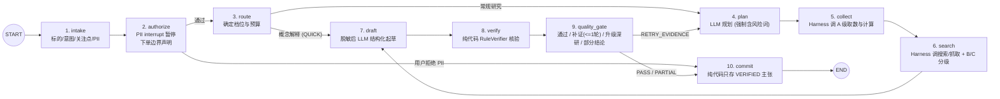
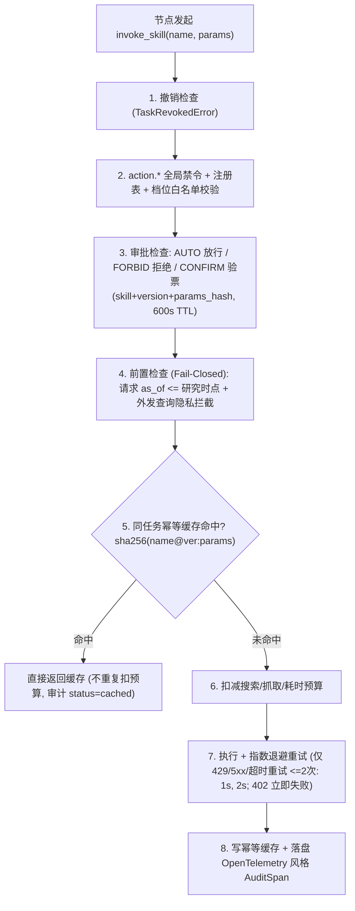

# Stage 2：Harness 安全控制台与 LangGraph 10 节点固定状态图

> **对应原文档章节**：项目题第 2、3、11、11.1、11.2、12、16、28、29、30 题；八股：Agent 基础、ReAct vs 状态机、LangGraph、Harness Engineering、幂等、指数退避重试、OpenTelemetry。

---

## 一、本阶段要解决的痛点

即便有了 Stage 1 的核验器，如果仍沿用自由循环的 ReAct Agent：
1. 模型可能跳过取数、不按规范路径执行、陷入死循环烧干 Token；
2. 用户的“我有 30 万存款、房贷每月 8000”可能直接拼进搜索词泄露给外部搜索引擎或云端大模型；
3. 网络超时、进程中断、人工审批暂停后无法断点续跑，重试还可能重复扣搜索预算。

**Stage 2 的核心思想（Harness Engineering）**：**专家（模型）决定做什么，Harness（代码与状态图）决定能做什么、花多少、在哪停下。**

---

## 二、两张核心流程图（还原原文档图 2 与第 11 题配图）

### 图 2：快查 / 标准研究 10 节点主链路



### Harness 执行器单次 Skill 调用治理链路（还原原文档第 11 题配图）



---

## 三、本阶段代码地图与设计导读

| 模块文件 | 核心类 / 函数 | 设计意图与必看细节 |
| :--- | :--- | :--- |
| [policies.yaml](../config/policies.yaml) | 三档预算与白名单策略 | `quick`(8万tok/3搜/0补证)、`standard`(30万tok/15搜/1补证)、`deep`(120万tok/40搜/1补证)；跨任务缓存 TTL（行情财报 12h / 搜索 24h） |
| [privacy.py](../src/zhengyan/harness/privacy.py) | `PrivacyGuard` | 识别身份证、银行卡、手机号、个人财务陈述（持仓/存款/房贷+金额）；提供外发硬阻断 `assert_safe_outbound` 与模型输入脱敏 `mask_for_llm` |
| [approval.py](../src/zhengyan/harness/approval.py) | `ApprovalTicket`, `canonical_params_hash` | 票据强绑定 `skill + version + sha256(params)`，默认 600s 过期，参数变更或超时均拒签 |
| [budget.py](../src/zhengyan/harness/budget.py) & [audit.py](../src/zhengyan/harness/audit.py) | `BudgetTracker`, `AuditTrail` | 管控 token / 搜索 / 抓取 / 耗时四维预算；记录含 `trace_id / span_id / node_name / caller / duration_ms` 的全链路审计 Span |
| [executor.py](../src/zhengyan/harness/executor.py) | `HarnessExecutor`, `RegisteredSkill` | 所有 Skill 与 LLM 调用的唯一门面；前置检查与脱敏器均坚持 **Fail-Closed（检查器本身崩溃也默认阻断）** |
| [mock_client.py](../src/zhengyan/llm/mock_client.py) | `MockLLMClient` | 离线确定性 LLM 模拟器，支持 `inject_hallucination`、`simulate_gap_on_round_0`、`simulate_high_disagreement` 等可控场景 |
| [state.py](../src/zhengyan/graph/state.py), [nodes.py](../src/zhengyan/graph/nodes.py), [workflow.py](../src/zhengyan/graph/workflow.py) | `ResearchState`, `GraphRuntime`, `ResearchRunner`, `create_default_checkpointer` | 10 节点状态图 + 白名单安全序列化的 `MemorySaver` 检查点 + 原生 `interrupt()` / `Command(resume=...)` |

---

## 四、核心工程与架构细节精讲

### 1. Harness、Prompt、Context Engineering 的三角关系
- **Prompt Engineering**：把任务说清楚（发挥模型上限，但结果非确定性）；
- **Context Engineering**：动态组装正确的信息（检索、记忆、`<method_hints>`）；
- **Harness Engineering**：从运行环境层面提供确定性底线（状态图、白名单、预算、审批、规则核验）。三者叠加而非替代。
- **设计边界**：不要把所有事都写死成规则。本项目只硬性卡住“授权、核验、提交、预算、权限”五个关键检查点，节点内部怎么规划和起草仍交给模型。

### 2. LangGraph `interrupt()` + `Command(resume=...)` 的真实执行语义
跑 `examples/stage2_demo.py` 时注意观察节点轨迹：
`['intake', 'authorize', 'authorize', 'route', ..., 'commit']`
- 为什么 `authorize` 出现了 2 次，而 `intake` 只执行了 1 次？
  - LangGraph 在 `authorize` 中触发 `interrupt(...)` 时，会立即把当前状态存入 Checkpointer 挂起；
  - 用户回复后用 `Command(resume=...)` 续跑时，LangGraph **绝不会重跑上游已完成的 `intake` 节点**，而是从头重放被中断的 `authorize` 节点并在 `interrupt()` 处直接吐出用户的回复。
  - **关键推论**：`interrupt()` 之前的节点内逻辑必须幂等无副作用；不可序列化的运行时依赖（`HarnessExecutor`、连接池等）要放进闭包 `GraphRuntime` 而非 `ResearchState` 中。

### 3. 质量门控三结局与预算耗尽降级原则
- **PASS（通过）**：标准研究要求已核验事实 `>= 3` 条、存疑主张 `== 0`、且具备同口径派生指标；
- **RETRY_EVIDENCE（退回补证）**：不达标且 `supplement_rounds < max_supplement_rounds`（标准最多 1 轮，快查 0 轮）、仍有搜索预算、且起草列出 `evidence_gaps`；
- **PARTIAL（部分结论）**：补证用尽或预算耗尽时绝不硬凑结论，也**绝不跳过 `verify`**，而是把缺口和存疑项如实标注“未知”后提交。

---

## 五、动手验证与推荐小实验

```bash
# 运行 Stage 2 全部 18 项单测
uv run pytest tests/stage2 -v

# 体验含隐私提问触发 interrupt 暂停 → Command(resume) 续跑 + 质量门控退回补证
uv run python examples/stage2_demo.py
```

---

## 六、面试高频 Q&A（结合原文档）

- **Q1：为什么不用 ReAct，而用 LangGraph 显式状态机？（对应原文档第 2 题 & 八股）**
  - **答题骨架**：ReAct 让模型自由决定 Think-Act-Observe 下一步，在开放任务灵活，但在投研中有两个硬伤：一是模型可“决定”跳过取数凭记忆编数字；二是执行路径不固定，无法审计复现。LangGraph 把“路和红绿灯”交给代码定（必经授权、核验、提交，补证最多 1 轮），模型只在规划/起草节点内按 Pydantic 契约工作。
- **Q2：幂等、重试和检查点分别解决什么问题？（对应原文档第 11.1 题 & 八股）**
  - **答题骨架**：
    - **同任务幂等**：用 `sha256(skill@version:canonical_params)` 防止同一任务内重复扣搜索/抓取预算（注意与跨任务 12h/24h 数据缓存区分）；
    - **指数退避重试**：只对 429/5xx/超时重试最多 2 次（1s、2s 退避防惊群），对 402 余额不足等不可重试错误直接失败；
    - **Checkpointer**：每步落盘状态（生产存 MongoDB），审批暂停期间进程可退出，恢复时从断点续跑不重跑前面昂贵的取数。
- **Q3：为什么选 LangGraph 而不选 CrewAI / AutoGen？（对应原文档第 30 题 & 八股）**
  - **答题骨架**：CrewAI 偏角色分工流水线，AutoGen 偏开放对话协作，状态转移、硬权限拦截和人在环中断控制较弱；金融投研需要显式状态图、原生 Checkpointer、`interrupt/Command` 以及 `Send` 并行，LangGraph 控制力最强。
