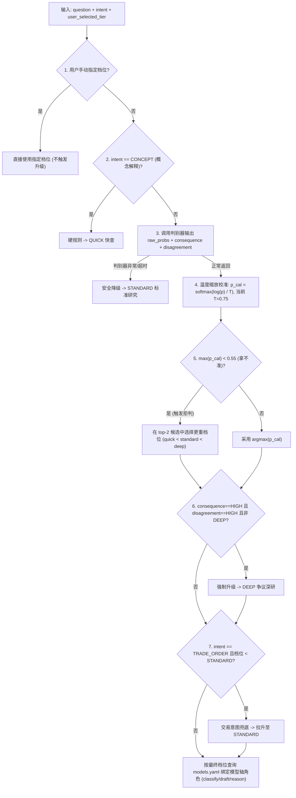

# Stage 3：双轴路由、温度缩放校准（ECE / NLL）与评测体系

> **对应原文档章节**：项目题第 1、1.1、1.2、4、5、5.1、5.2、27 题；八股：模型校准、ECE、NLL、温度缩放、随机波动检验。  
> **岗位权重**：⭐⭐⭐ **算法岗核心考察章节**。

---

## 一、本阶段要解决的痛点

Stage 2 跑通后，所有问题全走同一条重研究链路显然不合理——问“什么是市盈率”也要查财报搜网页等几分钟；而单纯引入一个分类器做路由，又会立刻遇到三个典型的机器学习落地问题：
1. **概率不可信（欠自信 / 过度自信）**：判别器输出 `0.60` 时实际准确率可能已经 `90%`，直接按概率定拒判阈值会引发大量误拒判；
2. **错误代价高度不对称**：把高风险深研问题错判成快查的损失远大于把快查错判成标准研究；
3. **LLM 判别器随机波动**：原项目踩过的真实大坑——按校准结果把温度从 `1.0` 改成 `0.75`，重跑 24 题金标准确率从 `92%` 掉到 `83%`，排查后才发现同一次运行的原始概率换三种温度准确率完全一致，真正掉分的原因是 LLM 自身的随机采样抖动！

---

## 二、7 步双轴路由决策流（还原原文档第 5 题配图）



---

## 三、本阶段代码地图与设计导读

| 模块文件 | 核心类 / 函数 | 设计意图与必看细节 |
| :--- | :--- | :--- |
| [models.yaml](../config/models.yaml) & [models_config.py](../src/zhengyan/routing/models_config.py) | `ModelAxisConfig`, `ModelRoleSpec` | **双轴解耦**：代码只认抽象角色（`classify / draft / reason`），具体型号在 YAML 配置；深研中仅估值研究员、反证官、主席用 `reason`，其余专家用 `draft` |
| [calibration.py](../src/zhengyan/routing/calibration.py) | `temperature_scale`, `compute_ece`, `compute_nll`, `compute_reliability_bins`, `fit_temperature`, `replay_raw_probs_accuracy` | 数值稳定温度缩放、10 桶可靠性曲线、ECE/NLL 离线网格搜索最优温度 $T^*$、同概率回放验证保序性 |
| [classifiers.py](../src/zhengyan/routing/classifiers.py) | `is_trade_order_by_rule`, `RuleFirstIntentClassifier`, `MockRoutingClassifier` | 交易意图硬规则永远优先（区分祈使下单 vs 疑问分析干扰题）；`MockRoutingClassifier` 支持 `underconfident_scale` 与 `noise_std` 模拟 LLM 采样漂移 |
| [router.py](../src/zhengyan/routing/router.py) | `DualAxisRouter`, `RoutingDecision` | 严格落地 7 步优先级链，完整记录 `raw_probs`、`calibrated_probs`、`abstained`、`step_triggered` 与 `model_bindings` |
| [evaluator.py](../src/zhengyan/routing/evaluator.py) | `evaluate_routing`, `evaluate_intent`, `run_repeated_routing_eval` | 输出 Accuracy、**Deep Recall（硬要求 100%）**、Abstain Rate、ECE、NLL、以及多次重复运行的 `spread` 与逐题一致率 |
| [routing_cases.json](../evals/golden/routing_cases.json) | 24 题路由金标 | 8 `quick` + 8 `standard` + 8 `deep` |
| [intent_cases.json](../evals/golden/intent_cases.json) & [intent_holdout.json](../evals/golden/intent_holdout.json) | 38 题原集 + 26 题留出集 | 共含 20 道下单题（8 + 12 种新说法）与 14 道“提到买卖但实际在提问”的防背答案干扰题 |

---

## 四、算法岗核心公式与深度精讲

### 1. Temperature Scaling（温度缩放）的数学性质
给定原始概率分布 $p$，取对数还原 logits 后除以温度 $T > 0$ 再做 softmax：
$$z_k = \log(\max(p_k, \epsilon)), \qquad \tilde{p}_k(T) = \frac{\exp(z_k / T)}{\sum_{j} \exp(z_j / T)}$$
- **$T > 1$**：分布变平，修正模型过度自信；
- **$T < 1$**：分布变尖，修正模型欠自信/保守（本项目 DeepSeek 偏保守，离线拟合选 $T = 0.75$）；
- **严格单调保序**：$T > 0$ 绝不改变 $\arg\max_k \tilde{p}_k(T)$，所以纯 Top-1 准确率不变；它在线上真正改变的是**校准后最高置信度是否跌破拒判阈值 `0.55`**，从而影响拒判率与成本。

### 2. ECE 与 NLL，以及“100% 准确率小样本坍缩”陷阱
- **ECE（期望校准误差）**：按最高置信度分 $M=10$ 个等宽桶 $B_m$，衡量置信度与真实准确率的加权平均绝对偏差：
  $$\text{ECE} = \sum_{m=1}^{M} \frac{|B_m|}{N} \left|\text{acc}(B_m) - \text{conf}(B_m)\right|$$
- **NLL（负对数似然 / 交叉熵）**：
  $$\text{NLL} = -\frac{1}{N} \sum_{i=1}^{N} \log(\max(\tilde{p}_{i, y_i}, \epsilon))$$
- **高阶陷阱（见 `stage3_demo.py` 实测）**：如果校准集样本少且纯 argmax 准确率恰好是 `100%`，无约束最小化 ECE 或 NLL 会把 $T^*$ 压到下界 `0.20`（过锐化坍缩成 one-hot），一旦上线遇到难例会产生灾难性的过度自信。工程上必须结合含错例的验证集看 NLL、设置温度步长下界，并把温度修改纳入 **Stage 6 的 S2 RSI 门控**。

### 3. 还原“92% → 83%”教训：同概率回放 vs 多次重跑
- `stage3_demo.py` 直观复现了两个结果：
  1. 对同一份保存下来的原始概率回放 `T=0.50 / 0.75 / 1.00`，纯 argmax 准确率恒为 `95.0%`（纹丝不动）；
  2. 给 LLM 判别器加上采样噪声重跑 3 次，24 题上准确率在 `[95.8%, 91.7%, 87.5%]` 之间跳动（`spread = 8.3%`，逐题一致率仅 `75%`）。
- **结论**：24 题里多错 2 道就是 `8.3%` 的波动！单次跑分提升毫无统计意义——这直接催生了 **Stage 6 噪声门控（至少重复 3 次，净提升 > max spread）** 与 **Stage 7 确定性小模型 Kev-0.8B**。

---

## 五、动手验证与推荐小实验

```bash
# 运行 Stage 3 全部 14 项单测
uv run pytest tests/stage3 -v

# 查看离线温度拟合、可靠性分桶、92%->83% 随机波动复现与 24+64 题评测报告
uv run python examples/stage3_demo.py
```

**推荐动手试一下**：把 `examples/stage3_demo.py` 中 `abstain_threshold` 调到 `0.80`，观察拒判率飙升时“深研召回维持 100% 但大量标准题被误升级导致成本上涨”的 Precision-Recall-Cost 权衡。

---

## 六、面试高频 Q&A（结合原文档）

- **Q1：为什么把路由拆成任务轴和模型轴“双轴”？（对应原文档第 4 题）**
  - **答题骨架**：任务轴决定“研究多深”（快查/标准/深研，控搜索与多专家开销），模型轴决定“每个角色用多强的模型”（`classify / draft / reason` 写在 `models.yaml`）。拆开后，降本换模型或灰度切小模型只改模型轴配置，完全不动任务路由逻辑。
- **Q2：为什么拒判一定要往更重（更深度）的流程升？（对应原文档第 5.2 题）**
  - **答题骨架**：两类错判的业务损失严重不对称——漏判高风险问题可能让用户拿片面结论决策，误升轻问题只多花几分钱。因此把 **Deep Recall = 100%** 定为硬红线，拿不准时在 top-2 里选更重档位；同时监控 **Abstain Rate（拒判率）** 防止成本失控。
- **Q3：怎么防止意图识别规则在测试集上“背答案”？（对应原文档第 1.1 题）**
  - **答题骨架**：先写死 26 题留出集（Holdout Set，含 12 种全新口语下单说法 + 14 道带“买入/卖出/减持/抄底/限价单”关键词但实际在提问或讨论机构行为的干扰题），再基于“疑问语境过滤 + 祈使/数量委托句法结构”实现规则，最终在 38+26 共 64 题上实现下单 **20/20 识别、0 误报**。
