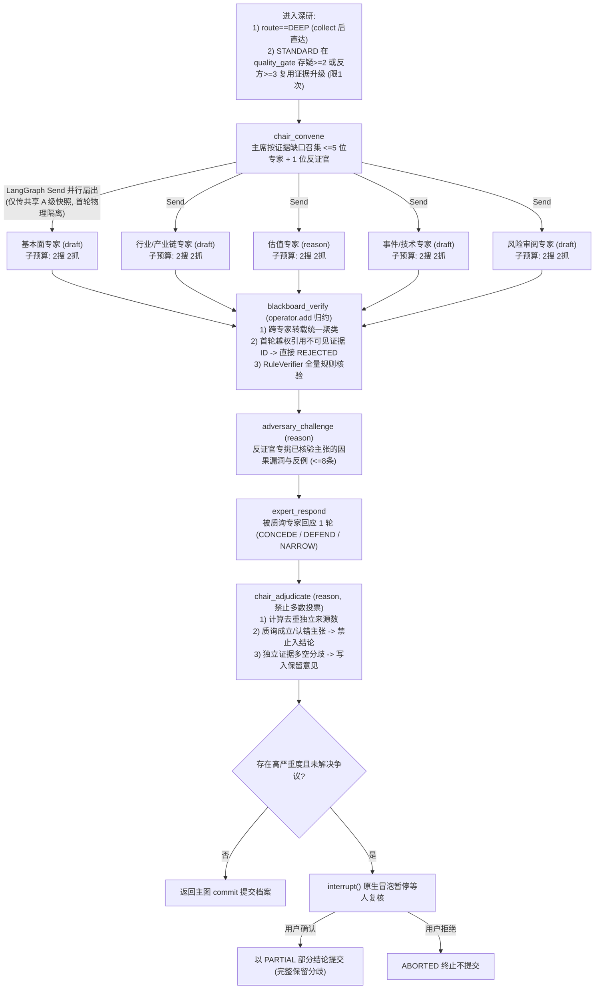

# Stage 4：多专家争议深研子图与单 Agent 对照评测

> **对应原文档章节**：项目题第 1、13、14、15、16、27、28 题；八股：LangGraph `Send`、多 Agent 框架对比。  
> **岗位权重**：⭐⭐⭐ **多 Agent 协作与无偏评测核心章节**。

---

## 一、本阶段要解决的痛点

面对“贵州茅台估值合理吗、还要不要继续持有”这类高后果、高分歧问题，单 Agent 极易出现**确认偏误（一边倒）**——看到利好就只写利好；但如果粗暴地把多个 Agent 凑到一起互相看结论再投票，又会踩进两个大坑：
1. **从众与互相抄（Information Cascade）**：后面的专家顺着第一位专家的观点写，“一致同意”毫无增量信息；
2. **转载假多数（伪独立投票）**：3 个专家看的是同一篇转载稿的不同媒体链接，投 3 票本质上依然只有 **1 条独立信源**。

---

## 二、争议深研子图架构（还原原文档图 3）



---

## 三、本阶段代码地图与设计导读

| 模块文件 | 核心类 / 函数 | 设计意图与必看细节 |
| :--- | :--- | :--- |
| [state.py](../src/zhengyan/deep/state.py) | `DeepResearchState`, `ExpertWorkerInput` | 用 `Annotated[list[ExpertSubmission], operator.add]` 归约并行 `Send` 分支；`ExpertWorkerInput` 物理限定只含共享 A 级快照 |
| [subgraph.py](../src/zhengyan/deep/subgraph.py) | `compile_deep_research_subgraph`, `count_independent_sources`, `_unify_cross_expert_clusters` | 完整 6 步深研子图；跨专家统一转载事件簇；首轮隔离违规引用直接 `REJECTED`；高危未决争议 `interrupt()` 冒泡到父图 Checkpointer |
| [prompts_mock.py](../src/zhengyan/deep/prompts_mock.py) | `MockDeepResearchEngine`, `ALL_OPTIONAL_EXPERTS` | 还原茅台合同负债 `-42%` 因果质询成立拦截、估值派生估算数字标存疑、同源转载刷票与高危未决争议场景 |
| [ab_eval.py](../src/zhengyan/deep/ab_eval.py) | `compute_composite_quality_score`, `evaluate_ab_comparison` | 严格落地文档第 16 题纯代码综合质量分公式，在隔离命名空间（`single_agent_ns` vs `multi_expert_ns`）内对照评测并判定准入 |
| [ab_eval_cases.json](../evals/golden/ab_eval_cases.json) | 3 例高分歧对照用例 | 同一问题、同一 `as_of` 下分别跑单 Agent 与多专家 |
| [nodes.py](../src/zhengyan/graph/nodes.py) & [workflow.py](../src/zhengyan/graph/workflow.py) | `deep_research_node`, `_after_collect`, `_after_quality_gate` | 接通 `DEEP` 直达与 `STANDARD` 升级复用已取证据（限 1 次）两条路径 |

---

## 四、算法岗深度精讲

### 1. 为什么刻意不用多数投票（Majority Voting）？
Condorcet 陪审团定理成立的前提是**各投票者判断相互独立**。在金融多 Agent 场景里，三个专家分别抓到证券时报、新浪财经、东方财富三篇转载自同一原始稿件的文章，投出三票其实只有一个独立样本。
- 代码实现见 [subgraph.py](../src/zhengyan/deep/subgraph.py#L64-L82)：`_unify_cross_expert_clusters` 先跨专家做标题规范化 + SimHash + `original_source` 归并，再由 `count_independent_sources` 统计独立信源数——3 位专家复读同篇转载稿，独立来源数严格等于 **1**。

### 2. 规则核验器 + 反证官的双层互补（完美衔接 Stage 1 与 Stage 6）
看 `stage4_demo.py` 中茅台 600519 的两条被拦截主张：
- **`EXP-VAL-DERIVED-EST`**（“反推隐含未来三年复合增速 11.5%”）：属于**数字无出处**，在 `blackboard_verify` 就被纯规则核验器标为 `DOUBTFUL` 拦下；
- **`EXP-FUN-CL-CAUSAL`**（“合同负债同比下降 42.00%，直接说明终端消费需求明显走弱”）：数字 100% 精确，**规则核验器放行了**；但在 `adversary_challenge` 中被反证官用“打款节奏调整”公告推翻（质询 `CHG-01` 成立），最终由主席挡在结论之外——并且这条成立的质询将在 **Stage 6** 自动沉淀为泛化经验卡 `L-007`！

### 3. 纯代码综合质量分与多专家准入判据（为什么不用 LLM-as-a-Judge？）
$$\text{CompositeScore} = 0.30 \cdot \text{核验通过率} + 0.30 \cdot \text{关键项覆盖率} + 0.25 \cdot \text{数字可复算率} + 0.05 \cdot \frac{\min(\text{保留分歧}, 3)}{3} + 0.10 \cdot \mathbb{I}(\text{门控通过})$$
- **权重偏重可核验性（55%）**：与系统“可信研究底稿”的定位一致，避免 LLM-as-a-Judge 偏爱文采华丽但瞎编数字的报告，同时消除评审随机噪声；
- **跑前定死准入判据**：质量差 $\Delta Q \ge -0.02$ 且 Token 倍数 $\le 5.0\times$ 两条同时满足才准入；
- **细腻的实证洞察（面试加分！）**：多专家的数字可复算率反而比单 Agent 更低（实测 `82.2%` vs `100.0%`），因为专家写得越深越容易冒出估算型派生数字，全被核验器标成存疑拦在结论外——这既证明了规则核验器的不可替代性，也证明了**系统默认应走单 Agent，只有高分歧高后果问题才值得花 3–4 倍 Token 启深研**。

---

## 五、动手验证

```bash
# 运行 Stage 4 全部 7 项单测（含隔离违规拦截、3专家同源去重、高危争议 interrupt 与 3 例对照评测）
uv run pytest tests/stage4 -v

# 查看茅台多专家对抗全过程与单 Agent 对照表
uv run python examples/stage4_demo.py
```

---

## 六、面试高频 Q&A（结合原文档）

- **Q1：争议深研为什么要首轮隔离，怎么在工程上防止专家偷看？（对应原文档第 13 & 27 题）**
  - **答题骨架**：防止从众效应和互相抄袭，让多视角一致真正具有信息量。工程上两层落实：第一，LangGraph `Send` 下发 `ExpertWorkerInput` 时物理上只注入共享 A 级结构化快照，每名专家用角色前缀命名自己的私有网页 ID（`EV-EXP-{role}-WEB-...`）；第二，`blackboard_verify` 检查每条主张的引用 ID 是否落在其 `visible_evidence_ids` 内，跨视角偷看直接 `REJECTED`。
- **Q2：高严重度争议一直僵持不下怎么办？（对应原文档第 11.2 & 14 题）**
  - **答题骨架**：深研子图以 `checkpointer=None` 嵌入主图，在 `chair_adjudicate` 检测到高严重度未决争议时调用 `interrupt()` 原生冒泡暂停，交由人工复核：用户确认后以 `PARTIAL` 部分结论提交并完整保留分歧，拒绝则 `ABORTED`，不回复就一直暂停、绝不默认同意。
- **Q3：标准研究中途升级深研会不会浪费之前查的数据或陷入死循环？（对应原文档第 5 题）**
  - **答题骨架**：不会。`quality_gate` 触发 `ESCALATE_DEEP` 后直接复用已收集的 `evidence_store`（`collect` 不重跑），并将 `escalated_to_deep` 置 `True`，硬性限制单次任务最多升级一次。
