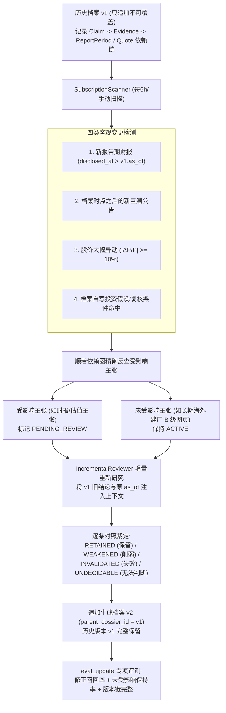

# Stage 5：五类版本化记忆、依赖链增量复核与前向模拟盘

> **对应原文档章节**：项目题第 12、17、17.1、18、31、32 题；八股：前视偏差、幸存者偏差。

---

## 一、本阶段要解决的痛点

普通投研助手的结论是一次性的：两个月后新财报披露或股价大跌，用户再问一遍，系统要么从头重写一份前言不搭后语的新报告，要么靠向量库翻出过期旧聊天记录胡乱拼接；而在策略验证上，做历史回测又极易掉进“看着历史写规则、再回测同一段历史”的过拟合与前视偏差陷阱。

**Stage 5 的核心思想**：用**只追加版本链 + 精确依赖图**管理研究记忆，用**四类事件驱动的增量复核**维持结论鲜活，用**纯本地个人情境官**保护风险隐私，用**禁止回填的前向模拟盘**做干净的策略验证。

---

## 二、四类变更订阅与精确增量复核流程（还原原文档第 18 题配图）



---

## 三、本阶段代码地图与设计导读

| 模块文件 | 核心类 / 函数 | 设计意图与必看细节 |
| :--- | :--- | :--- |
| [store.py](../src/zhengyan/memory/store.py) | `FiveLayerMemoryStore`, `VersionedDossier`, `UserConfirmedConstraints`, `InvestmentHypothesis` | 五类记忆强权限隔离；`_extract_dependencies` 递归展开计算卡 `derived_from` 形成精确依赖边；`purge_expired_working_memory` 实现 30 天 TTL 清理 |
| [incremental.py](../src/zhengyan/memory/incremental.py) | `SubscriptionScanner`, `IncrementalReviewer`, `evaluate_incremental_update` | 4 类变更扫描、只标受影响主张为待复核、走通宁德时代 `300750` “提醒 → 重研 → v2” 闭环，以及持续更新评测（对应 `advisor eval update`） |
| [personal_advisor.py](../src/zhengyan/memory/personal_advisor.py) | `PersonalContextAdvisor` | **纯本地确定性规则、零 LLM 调用**；用户将回撤约束从 20% 改为 10% 时，`detect_constraint_change_impacts` 自动标出受影响档案 |
| [paper_trading.py](../src/zhengyan/memory/paper_trading.py) | `StrategyCard`, `ForwardPaperSimulator`, `evaluate_strategy_promotion_gate`, `StrategyRegistry` | `Decimal` 虚拟资金、等权、100 股整手、物理禁止历史回填（`BackfillForbiddenError`）、5 条纯代码晋级门控 + 人工批准晋级与一键回滚 |

---

## 四、五类记忆权限边界与算法评测要点

### 1. 五类记忆与不可逾越的写入隔离
| 记忆类型 | 存什么 | 谁有权写入（代码强制校验） |
| :--- | :--- | :--- |
| **1. 已核验事实** | 公开事实/事件（带来源与时点） | 仅系统规则核验 `VERIFIED` 且 `is_fact=True` 后写入 |
| **2. 用户确认约束** | 购买理由、资金期限、可承受回撤 | **仅用户本人显式勾选确认可写**，研究流程绝对无入口 |
| **3. 投资假设** | 结论依赖的假设与显式失效条件 | 研究产生，条件触发时自动标失效 |
| **4. 决策历程** | 证据快照、分歧、放弃方案、依赖链 | **只追加不覆盖**（重复写同 ID 抛 `MemoryPermissionError`） |
| **5. 方法经验** | 经验卡、路由参数、检索模板 | 仅 RSI 六道门控通过 + 人工批准后写入 |
| **工作记忆** | 中间检索与草稿缓存 | 30 天 TTL 自动清理 |

### 2. 为什么不用向量数据库做投研记忆？（对应原文档第 17.1 题）
投研复核要回答的是**精确集合依赖查询**：“哪些历史结论依赖了 `2024FY` 财报或 `2025-04-01` 行情？”——字段关联 + 递归展开 `derived_from` 可以做到 **100% 精准零误召回**；向量相似度检索反而会召回一堆“语义相关但并不依赖该报告期”的噪声。只有在未来经验卡增长到数百张以上、标签匹配覆盖不足时，才考虑对经验卡补充向量召回。

### 3. 前向模拟盘 5 条纯代码晋级门控（对应原文档第 32 题）
拒绝历史回测（防前视偏差与数据窥探过拟合），采用从起始日逐日向前推进的 **Forward Paper Portfolio**：
1. 至少运行 **10 个交易日**；
2. **零未来数据**：每笔交易引用的档案满足 `dossier_as_of <= trade_date`；
3. **最大回撤不超上限**；
4. **100% 可追溯且整手合法**：每笔成交绑定 `dossier_id` + `version` 且为 100 股整数倍；
5. **相对在用版本收益不落后超过 2%**；
全部通过后仍须**人工显式批准**才能晋级，且支持一条命令一键回滚到上一在用策略。

---

## 五、动手验证

```bash
# 运行 Stage 5 全部 7 项单测
uv run pytest tests/stage5 -v

# 体验宁德时代 300750 提醒->重研->v2、回撤约束 20%->10% 联动与 10 交易日前向模拟盘
uv run python examples/stage5_demo.py
```

---

## 六、面试高频 Q&A（结合原文档）

- **Q1：为什么不用“赚没赚钱”来评价投研 Agent 优劣？（对应原文档第 31 题）**
  - **答题骨架**：收益是结果，混杂了大量市场 Beta 和运气——牛市里胡说八道也能赚，扎实研究遇到黑天鹅也会亏。所以我们评的是**研究过程质量**：口径是否一致、数字能否在 A 级证据复算、是否区分事实与推测、是否找了反证、新证据到来后受影响结论是否被精准修正且未受影响结论被保留（`eval_update`）。
- **Q2：个人情境官为什么不做成大模型 Agent？（对应原文档第 12 & 18 题）**
  - **答题骨架**：两点原因——第一是**隐私零出境**，用户的可承受回撤、存款、房贷期限等约束完全在本机用纯确定性规则计算，绝不发给云端大模型；第二是**可复现联动**，用户把回撤从 20% 改成 10% 时，本地规则可瞬间扫遍全部标的最新档案，精确标出 `aligned -> misaligned` 发生变化的标的。
- **Q3：什么是前视偏差和幸存者偏差，本项目怎么防？（对应原文档八股）**
  - **答题骨架**：前视偏差是在历史时点偷用了未来才披露的数据（本系统按 `disclosed_at <= as_of` 取数、核验器拦截超前证据、前向模拟盘校验 `dossier_as_of <= trade_date` 且物理禁止历史回填）；幸存者偏差是只拿现存股票回测而忽略退市公司导致收益虚高（本系统直接不做历史回测，改用逐日前向模拟盘）。
