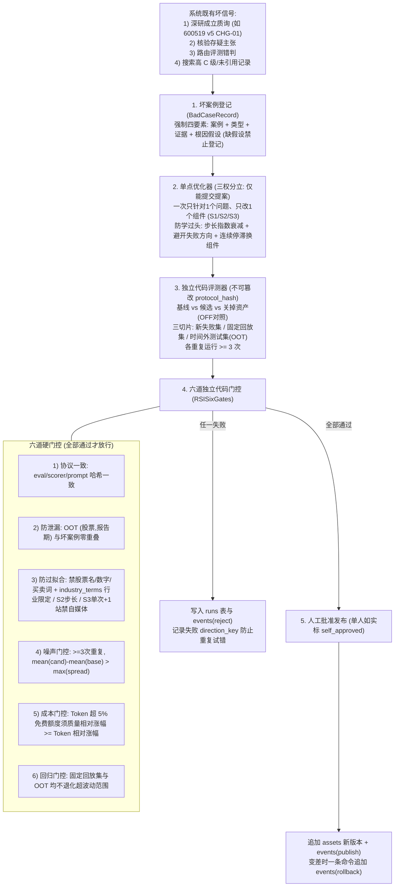
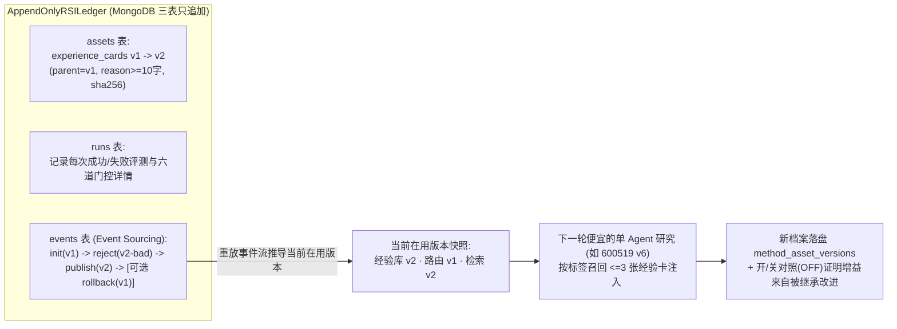

# Stage 6：RSI 受控自进化闭环、只追加账本与六道硬门控

> **对应原文档章节**：项目题第 1、19、20、21、22、22.1、23、24、25、27、33 题；八股：平衡准确率、Goodhart 定律、随机波动检验、RSI vs Reflexion。  
> **岗位权重**：⭐⭐⭐ **本项目最核心亮点 & 算法岗面试压轴章节**。

---

## 一、本阶段要解决的痛点

Stage 4 的多专家争议深研效果虽好，但成本高（3–4 倍 Token），而且辩论揪出的教训（例如“消费品公司合同负债大幅变动先排除打款政策调整，再推断需求变化”）用完就丢，下次便宜的单 Agent 遇到同类问题还是会再犯。

但让系统“自动改自己”极其危险——没有约束的优化器会**把测试题答案背进提示词（过拟合 / Reward Hacking）、把随机波动当成进步、甚至改坏旧题或碰触安全红线**。

**Stage 6 的核心思想**：**不碰模型权重训练，只改模型外围三类小资产（S1 经验卡 / S2 路由参数 / S3 检索模板），通过“三权分立 + 六道纯代码门控 + 只追加三表账本 + 人工批准”证明每一次改进既真实有效又被下一轮递归继承。**

---

## 二、两张核心流程图（还原原文档第 20 题与第 24 题配图）

### RSI 五步受控自进化闭环与六道门控（还原原文档第 20 题配图）



### 只追加三表账本与递归继承链（还原原文档第 24 题配图）



---

## 三、本阶段代码地图与设计导读

| 模块文件 | 核心类 / 函数 | 设计意图与必看细节 |
| :--- | :--- | :--- |
| [industry_terms.yaml](../config/industry_terms.yaml) | 行业专用词与禁词表 | 白酒/新能源/医药/银行行业词表、禁背公司名、禁买卖建议词、禁入白名单的自媒体域名 |
| [models.py](../src/zhengyan/rsi/models.py) | `BadCaseRecord`, `ExperienceCard`, `CandidateProposal`, `FORBIDDEN_RSI_TARGETS` | 四要素坏案例（`hypothesis` 少于 6 字直接报错）；硬定义 7 条红线（权限、隐私、核验规则、交易边界、用户约束、买卖推荐、模型权重）永不进入自进化 |
| [ledger.py](../src/zhengyan/rsi/ledger.py) | `AppendOnlyRSILedger`, `compute_content_hash` | 只追加三表 `assets / runs / events`；理由少于 10 字或试图覆盖旧版本直接抛 `LedgerViolationError`；`get_active_version` 由事件流重放推导 |
| [gates.py](../src/zhengyan/rsi/gates.py) | `RSISixGates`, `max_step_for_round`, `assert_not_redline_target` | 6 道纯代码门控，单测逐一完成攻防验证 |
| [experience.py](../src/zhengyan/rsi/experience.py) | `recall_experience_cards`, `format_method_hints_block`, `sample_1_bad_to_2_good_stable`, `compute_balanced_accuracy` | 标签召回 ≤3 张（0 命中不给）、`<method_hints>` 显式声明非证据非指令、1 坏配 2 好哈希稳定抽样与平衡准确率 |
| [pipelines.py](../src/zhengyan/rsi/pipelines.py) | `evaluate_s1_slice`, `evaluate_s2_replay`, `evaluate_s3_search_replay`, `RSIController` | 完整落地 S1（审稿平衡准确率 + OFF 对照）、S2（历史原始概率多轮回放）、S3（缓存搜索 `Precision × Recall` 确定性回放） |

---

## 四、算法岗核心指标与理论深度精讲

### 1. S1 为什么用平衡准确率（Balanced Accuracy）+ 1 坏配 2 好抽样？
在正负样本 1:2 不均衡的审稿数据集里，如果模型“全部放过”，普通准确率也有 $66.7\%$；但平衡准确率：
$$\text{BalancedAcc} = \frac{1}{2}\left(\text{TPR}_{\text{拦住坏主张}} + \text{TNR}_{\text{放过好主张}}\right)$$
对“全放过”只给 **50%**，逼迫经验卡必须同时提升坏主张拦截率且不误杀好主张。同时用 `sha256(salt:sample_id)` 稳定抽样保证不同轮次基线与候选跑在完全一致的样本集上。

### 2. S3 检索质量复合指标（Precision × Recall）
$$\text{SearchQuality} = \frac{\text{保留结果中可用 B 级数}}{\text{保留结果总数}} \times \frac{\text{权威结果中被保留且可抓取数}}{\text{全部权威结果数}}$$
只看 Precision 会鼓励把阈值拉到 0.99 漏掉权威报道；只看 Recall 会鼓励把所有垃圾网站都放进来；两者相乘迫使阈值与白名单调整必须兼顾精度与权威召回，而且白名单调整属于高风险操作（每次只加 1 站、只加不删、禁自媒体、须写审批理由）。

### 3. 用 Goodhart 定律串起六道门控（面试高分视角）
- **Goodhart 定律**：“当一个指标成为优化目标时，它就不再是好指标。”（强化学习中称 Reward Hacking）。
- 优化器拿到分数反馈后有 6 种典型作弊倾向：换题/换提示词（被门控 1 协议哈希锁死）、偷看考题（被门控 2 OOT 防泄漏锁死）、把具体答案背进卡片（被门控 3 防过拟合 + 行业词表锁死）、靠抽卡碰运气（被门控 4 噪声门控锁死）、堆提示词烧 Token 买分（被门控 5 成本门控锁死）、拆东墙补西墙（被门控 6 双切片回归门控锁死）。

### 4. RSI 四层演进 vs Reflexion
| 层次 | 含义 | 代表做法 |
| :--- | :--- | :--- |
| L1 改一次 | 只修当前这一次输出 | 草稿自查、单任务 Reflexion |
| L2 记住 | 教训持久化给后续任务用 | 写入经验卡 |
| L3 改“怎么改” | 改进评测与验证机制本身 | 坏案例沉淀进固定回放集 |
| **L4 RSI（本项目目标）** | **下一轮改进从上一轮已验证版本出发，经门控与账本持续积累并可证明继承** | `v1 -> v2 -> v3` 账本链 + `600519 v6` 继承 + OFF 对照 |

---

## 五、动手验证

```bash
# 运行 Stage 6 全部 12 项单测（含六道门控攻防、S1/S2/S3 三通道闭环与 600519 继承）
uv run pytest tests/stage6 -v

# 运行压轴演示：过拟合卡片被拦 -> L-007 过六道门控上线 v2 -> 600519 单Agent继承 -> 一键回滚
uv run python examples/stage6_demo.py
```

---

## 六、面试高频 Q&A（结合原文档）

- **Q1：为什么 RSI 只改外围资产（经验卡/路由参数/检索模板），不去微调或 RL 训练模型？（对应原文档第 25 题）**
  - **答题骨架**：四点工程权衡——① 零 GPU / 零 RL 环境即可落地；② 单点改动小、易做因果归因（知道到底是哪张卡或哪个参数起了作用）；③ 出问题一条命令按账本回滚，不像权重训练存在灾难性遗忘且难回滚；④ 天然契合现有 Harness、证据卡和离线评测体系。
- **Q2：怎么证明你做的是“递归自进化”而不是改了一次就结束了？（对应原文档第 24 题）**
  - **答题骨架**：靠四重账本证据：① 不可变 `assets` 表记录 `parent_version`、`>=10` 字改动理由与 `sha256` 哈希；② 当前版本由 `events` 表事件溯源推导，支持回滚；③ 下一轮真实档案（如 `600519 v6`）记录所继承的 `method_asset_versions`；④ 每轮做“开/关经验库（OFF）”对照，证明净增益来自被继承资产而非多花算力。
- **Q3：单人开发时 RSI 的“独立验收”怎么办？（对应原文档第 33 题）**
  - **答题骨架**：坦诚务实——系统账本区分了 `independent_approved` 与 `self_approved`，单人项目里绝不造假，如实标记为 `self_approved`，同时把评测器和六道门控做成确定性代码来维持客观约束。
