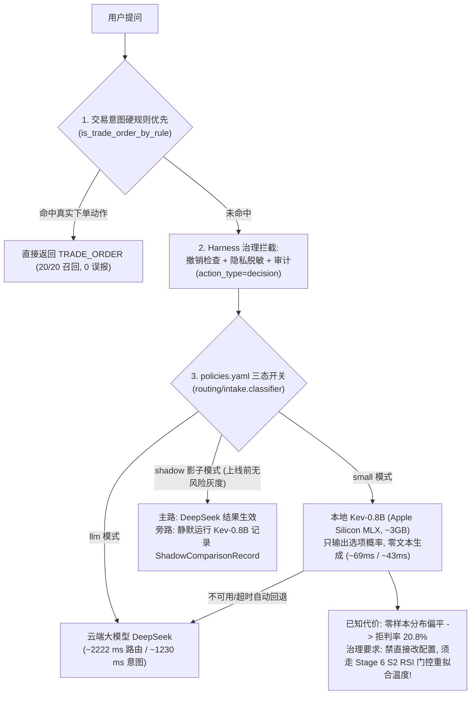

# Stage 7：Kev-0.8B 混合判别、FastMCP 只读服务与 FastAPI 控制台

> **对应原文档章节**：项目题第 1、26、26.1、30、34、35 题；八股：System 1 / System 2 大小模型混合、Agent Skills vs MCP vs Function Calling。  
> **岗位权重**：⭐⭐⭐ **算法推理加速、灰度上线与工程收口章节**。

---

## 一、本阶段要解决的痛点

研究链路里的模型调用本质分两类：
- **System 2（生成与深度推理）**：规划检索、起草报告、多专家分析、反证质询、主席裁决——必须用大模型；
- **System 1（闭集单选判别）**：意图四选一、路由三选一——只需要输出离散选项的概率分布，不需要写任何长文本。

之前全部交给云端 DeepSeek，导致每次请求在入口先白等 1～2 秒，还存在随机采样漂移（Stage 3 已验证）。此外，系统还需要对外以最小权限暴露只读能力（FastMCP）并向用户提供可视化的 5-Tab 控制台（FastAPI + 前端）。

---

## 二、Kev-0.8B 混合判别与影子灰度架构（还原原文档第 26 题配图）



---

## 三、本阶段代码地图与设计导读

| 模块文件 | 核心类 / 函数 | 设计意图与必看细节 |
| :--- | :--- | :--- |
| [kev.py](../src/zhengyan/routing/kev.py) | `DecisionModelBackend`, `MLXLocalKevBackend`, `Kev08BClassifier`, `HybridRoutingClassifier`, `HybridIntentClassifier`, `ClassifierMode` | 兼容 Jev/Kev 离散概率接口；支持 `llm / small / shadow` 三态开关、本地不可用自动回退 LLM、Harness 脱敏与 `decision` 审计 |
| [real_queries_replay.json](../evals/golden/real_queries_replay.json) | 22 条真实提问去重回放集 | 检验 Kev-0.8B 与 DeepSeek 在真实历史提问上的路由一致率（22/22 = 100%） |
| [mcp_server.py](../src/zhengyan/mcp_server.py) | `ReadOnlyMCPToolbox` | 仅对外暴露 5 个只读取数与 Decimal 计算工具，全走 Harness 与 `as_of` 校验，严禁任何 `action.*` 工具；支持一键导出 `FastMCP` |
| [app.py](../src/zhengyan/api/app.py) & [index.html](../web/index.html) | `create_app`, 5-Tab 控制台 | 提供研究台（含 HTTP `interrupt -> /resume`）、档案链、订阅扫描、RSI 账本与回滚、Kev 评测看板接口及开箱即用前端页面 |

---

## 四、量化对比与算法岗关键洞察

### 1. DeepSeek vs 本地 Kev-0.8B 实测对比（还原文档第 26.1 题）
| 评测维度 | DeepSeek（云端大模型） | Kev-0.8B（MLX 本地 0.8B，零训练） | 结论与权衡 |
| :--- | :--- | :--- | :--- |
| **路由准确率（24 题）** | 95.8% / 91.7%（多次漂移） | **95.8%（3 次 100% 一致）** | 准确率持平且彻底消除随机漂移 |
| **深研召回（24 题）** | 100% | **100%** | 守住高风险零漏判硬红线 |
| **路由判别中位耗时** | 2222 ms | **69 ms（提速 >30x）** | 入口零等待、零云端 Token 消耗 |
| **路由拒判率** | 4.2% | **20.8%（5/24）** | **主要代价**：分布偏平导致更多升重 |
| **意图准确率（38 / 26 留出）** | 100% / 100% | **97.4% / 100%（43 ms）** | 下单意图 20/20 召回、0 误报 |
| **真实提问回放（22 条）** | 基线 | **22/22（100% 一致）** | 线上分布泛化稳定 |

### 2. 为什么不直接手动把温度改小，而要走 S2 RSI 门控？（串联全项目！）
- Kev-0.8B 20.8% 的拒判率源于零样本小模型输出概率偏平；
- 在 [test_kev_hybrid_and_shadow.py](../tests/stage7/test_kev_hybrid_and_shadow.py#L149-L202) 中，我们完整演示了合规修复流程：收集 Kev 历史原始概率快照 → 作为 S2 候选提案提交（温度 `0.75 -> 0.48`，步长 `0.27 <= 0.30`）→ 过六道门控（协议一致、防泄漏、步长防过拟合、噪声、成本、回归）→ 人工批准上线，最终拒判率显著下降且深研召回维持 100%。

### 3. 硬件与算力坦诚口径
- 整个系统**无需独立 NVIDIA 显卡**，**未训练任何模型**；
- 唯一本地模型推理即 Kev-0.8B，在 Apple Silicon Mac 上跑 MLX 仅占约 **3 GB 统一内存**，且具备一键回退云端 LLM 开关。

---

## 五、动手验证与本地启动

```bash
# 运行 Stage 7 全部 6 项单测（或全量 93 项回归）
uv run pytest tests/stage7 -v
uv run pytest -v

# 运行 Stage 7 终章演示脚本
uv run python examples/stage7_demo.py

# 如需在浏览器访问 5-Tab 控制台（可选安装 uvicorn）
uv sync --extra server && uv run uvicorn zhengyan.api.app:app --reload
```

---

## 六、面试高频 Q&A（结合原文档）

- **Q1：为什么选 Kev-0.8B 而不是 4B 版本？（对应原文档第 26 题）**
  - **答题骨架**：以评测数据为准——0.8B 在 Mac MLX 上仅占 ~3 GB 内存，实测在 24 题路由（95.8% / 深研召回 100%）、64 题意图（原集 97.4% / 留出 100% / 下单 20/20 零误报）和 22 条真实提问回放（100% 一致）上已经与 DeepSeek 持平，耗时降到 43–69 ms，没必要为更大参数量多花内存与延迟。
- **Q2：Skills、MCP 和 Function Calling 有什么区别？（对应原文档八股）**
  - **答题骨架**：**Function Calling** 是模型层按 schema 输出函数名和参数的能力；**MCP（Model Context Protocol）** 是 Agent 与外部系统交互的标准协议（解决“去哪拿数据、能调哪些只读接口”，本项目用 FastMCP 暴露取数与计算 Skill）；**Skills** 固化的是完成某类任务的流程、规范与方法经验（注意区分 Anthropic 渐进式加载的 `SKILL.md` 与本项目工程上的“原子 Skill”函数契约，面试时主动点明不混淆）。
- **Q3：和竞品相比，证研的核心优势和已知不足分别是什么？（对应原文档第 34 & 35 题）**
  - **优势**：不拼预测涨跌，拼**可信、可追溯、可演进**——Harness 强制执行、A/B/C 分级 + 纯规则核验、多专家首轮隔离与非投票裁决、版本化依赖链增量复核、以及受六道门控约束的 RSI 自进化。
  - **主动暴露的 3 点不足（面试极加分）**：
    1. Kev-0.8B 零样本拒判率偏高（20.8%），需经 S2 RSI 门控重校准温度，若不够再在修订“零训练原则”前提下考虑蒸馏微调小判别模型；
    2. 公告目前只解析了标题与摘要，尚未深入解析 PDF 公告正文；
    3. 目前聚焦单股研判，尚未扩展到多股票组合相关性与行业轮动研究；免费数据源生态也弱于大厂平台。
